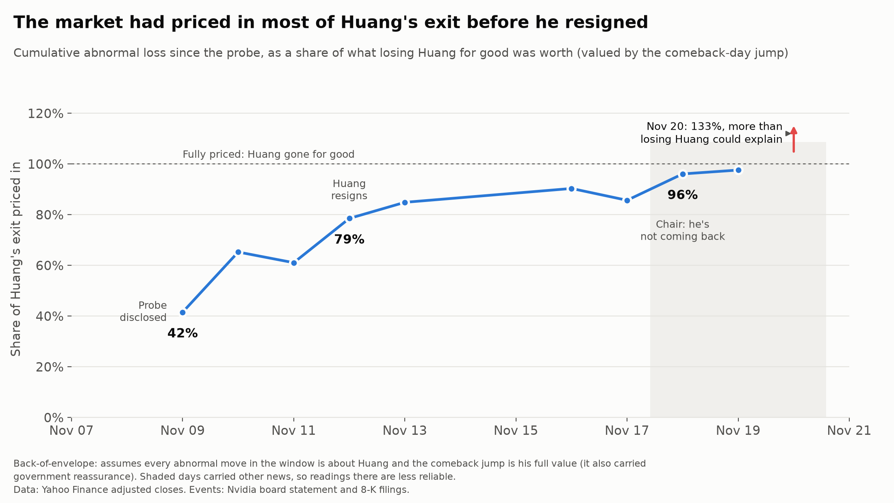
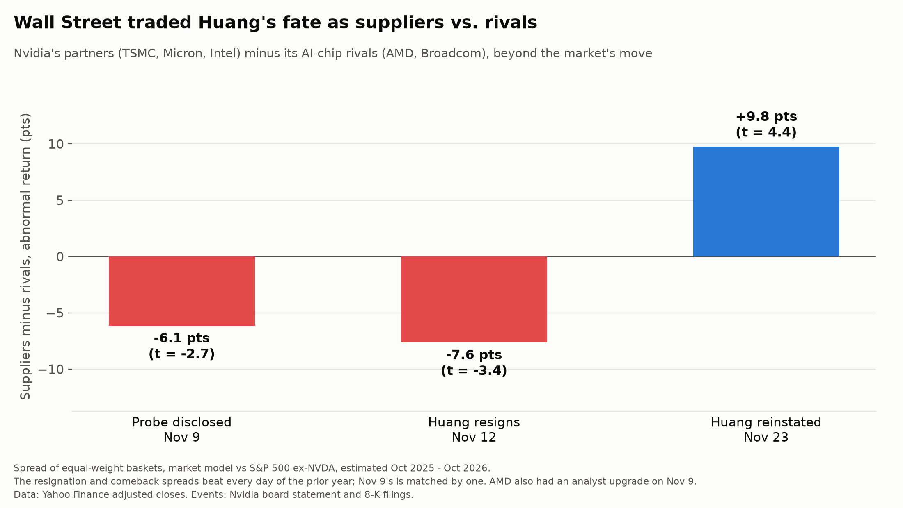

# The $800 Billion Comeback

*What Nvidia's stock did when Jensen Huang was investigated, quit, and came back, all in eleven trading days.*

On November 17, 2026, Nvidia's board chair said Jensen Huang would not be returning as CEO. Six days later the board reinstated him. Nvidia opened up 33% and by the close had added about $950 billion in market value, the biggest move of the whole episode and bigger than any day in the year before it.

It started on a Sunday. On November 8 the board announced it was investigating its own CEO after Huang told employees he'd had a relationship with a business executive whom U.S. intelligence reportedly suspected of spying for China. Four days later he resigned and CFO Colette Kress took over. By November 20 Nvidia had lost a third of its value, about $1.5 trillion.

So in less than two weeks, the market priced the company at the center of the AI boom with its founder, then without him, then with him again. That's about as close to a controlled experiment on a CEO's value as markets ever get. I wanted to know what each switch was worth, and what the pattern says about how investors were thinking.

The answers surprised me. The resignation was barely news, because by the time Huang quit the stock had already priced in most of his exit. His return was the real shock, and by one reasonable measure it implies that about a fifth of Nvidia's value rode on one person. A quarter in which revenue doubled didn't lift the stock at all. And the rest of the chip industry traded Huang's fate as a bet on Nvidia's suppliers against its rivals.


## Three announcements, three very different reactions

| | Nov 9: probe disclosed | Nov 12: Huang resigns | Nov 23: Huang reinstated |
|---|---|---|---|
| Stock's actual move | -4.3% | -4.3% | **+31.5%** |
| Move beyond what the market explains | -8.7% | -4.2% | **+26.5%** |
| In dollars | -$390B | -$180B | **+$800B** |
| Range across 24 model variations | -5.9% to -9.7% | -3.3% to -4.7% | +20.8% to +29.6% |
| Statistically clear? | Yes, in all 24 | Depends on the test | Yes, in all 24 |

"Beyond what the market explains" is the abnormal return. I estimate how Nvidia normally moves with the market, using a year of data that ends on October 23, before any of this started. Whatever Nvidia did on top of that is the abnormal part. The dollar figure applies that percentage to Nvidia's market value the night before.


## The market had already bet on his exit

The resignation came out around 9 a.m. Eastern on November 12. Nvidia opened 13% lower and at one point was down more than 14%. Then it spent the rest of the day climbing back, and closed down 4.3%. After adjusting for the market, the drop was 4.2%, small enough that whether it's statistically significant depends on how you model volatility.

The first reaction was panic. The considered one was a shrug. I think that's because by November 12 there wasn't much left to price.

One way to see it: suppose the comeback-day jump (+26.5%) is what having Huang is worth, compared with not having him. Then losing him for good should knock about 21% off the stock. If you track how much of that 21% Nvidia had already lost since the probe became public, you get a rough read on how sure investors were that he was gone.

- 42% after the first day
- 61% the night before he resigned
- 79% after he resigned
- about 90% a week later
- 96% after the board chair said he wasn't coming back



The resignation was less news than confirmation. Most of the damage was done in the two days after the board's Sunday statement.

Two other details jump out. Even after Huang formally quit, the market seems to have held back a sliver of hope that he'd return. Or my yardstick overstates his value, since the comeback day also carried government reassurance. Probably some of both. The second detail is November 20, when the measure shoots past 100% to 133%. That day the stock fell further than losing Huang permanently could explain, which is a strong hint the Nov 20 crash was about something else. More on that below.

This is a back-of-envelope reading, not a formal probability. It assumes every abnormal move in the window is about Huang, so it's least reliable on the days with other news.

## Why the comeback was worth so much

Prices move on surprises, and this was a big one. On the morning of November 23, a market that had priced Huang as almost certainly gone had to reprice to zero. The board chair had ruled out a return six days earlier. Nvidia closed up 31.5%, or 26.5% beyond the market, nearly 13 times a normal day's noise.

Turn that around and it says something striking. By this measure, about a fifth of what Nvidia was worth with Huang rode on Huang. This is a company with tens of thousands of employees, a dominant product line and a quarter of 103% revenue growth behind it, and one person still carried that much of the valuation.

There's a catch, and it matters. The board's filing said it had received input from senior levels of the U.S. government and was confident Huang's return posed no national security risk. So the $800 billion is partly Huang and partly relief that Washington seemed to be on board. Treat "a fifth of the company" as an upper bound.


## Revenue doubled and the stock fell

Nvidia reported third-quarter results after the close on November 17. Revenue came in at $115.8 billion, up 103% from a year earlier, and the company raised its outlook for next year. The following day the stock fell 2.9%, or 2.7% beyond the market.

Earnings weren't the only news, though. The same day, the board chair said Huang wasn't coming back and the Wall Street Journal reported an SEC probe. The implied-odds measure jumped from 86% to 96%.

So I can't say the earnings were worth nothing. What I can say is that in a week when the CEO question was open, a doubling of revenue was completely drowned out. The comeback moved the stock roughly ten times as much as earnings day did.

## The $1.5 trillion crash mostly wasn't about Huang

From November 9 through 23, Nvidia trailed the market by about 9.7%, or roughly $440 billion. Add up just the three Huang days and they come out *positive*, because the comeback outweighs the two drops. The net loss sits on the other eight days.

A lot happened on those days. On top of earnings and the SEC report, there were reports of a halt to H200 sales to China and a subpoena from California's attorney general. Then on Friday, November 20, chip stocks sold off hard. Nvidia opened only slightly lower, slid all day, and closed down 14%. It was the worst session of the episode, and the one where the implied-odds measure broke above 100%.

None of that is a Huang event, so I don't count it as one. Those days are shaded in the charts and listed with sources in [`data/confounders.csv`](data/confounders.csv).

## The Huang trade: long suppliers, short rivals

On reinstatement day, Micron rose 19%, Intel 16% and TSMC 14%. Taken one at a time, most of that is market beta. The whole market was up about 3%, and these stocks typically move two to three times as much as the market does. After correcting for 30 separate tests, only TSMC beats its prediction on its own.

Split the chip stocks into two camps, though, and a sharp pattern shows up. One camp is Nvidia's partners: TSMC builds its chips, Micron supplies its memory, and Intel works with it on products. The other camp is its AI-chip rivals, AMD and Broadcom. Here's how the gap between the two camps moved:

- When the probe was disclosed, the partners fell 6.1 points behind the rivals (t = -2.7).
- When Huang resigned, they fell 7.6 points behind (t = -3.4).
- When he came back, the partners beat the rivals by 9.8 points (t = 4.4).

The resignation and comeback gaps are bigger than any day in the prior year. The disclosure-day gap is a little muddied, because AMD also got an analyst upgrade that morning.



The market read Huang's job status as news about who wins the AI chip race. With him out, Nvidia's competitors looked better and its partners looked worse. With him back, it flipped. Investors repriced the whole ecosystem around one person.


## Measuring Nvidia against itself

The first trap I ran into: the obvious yardstick, the S&P 500, is about 8% Nvidia. On a day when Nvidia jumps 31%, the S&P goes up partly *because of* Nvidia. Measure against it and you're comparing Nvidia with a slice of itself, which knocks a few points off the answer.

So I rebuilt the S&P 500 without Nvidia. I started from Nvidia's index weight on October 23 (7.77%, according to WhichIndex) and let it drift each day with Nvidia's price relative to the index. To check it, I compared the weights it implies on other dates with published holdings: 8.45% vs. 8.50% on October 2, and 7.59% vs. 7.58% on October 31. It also tracks Nvidia much better than the equal-weight S&P 500 does (R² of 0.24 vs. 0.05), so it became my main benchmark.

## Building a fake Nvidia to check my work

A regression is one way to estimate what Nvidia "should" have done. Another is to build a stand-in. I found the mix of stocks that best tracked Nvidia's daily returns from April to October: about half TSMC, plus the S&P 500 ex-Nvidia, Meta, Microsoft and Broadcom. Then I froze that mix and let it run through November.

At the November 20 low, the real Nvidia was 25% below its stand-in, about five times the gap you'd normally see over that many days. After the reinstatement the gap shrank to about 10%, which is just inside two standard deviations of normal drift.

To make sure this wasn't an artifact of the method, I ran the same thing on each of the 10 stocks in the pool, pretending each one was the company in the news. Nvidia had the most extreme gap on 8 of the 11 days. With only 11 stocks the smallest possible p-value from that test is 0.09, so I treat it as strong supporting evidence rather than proof. Swapping out TSMC, or using only non-chip stocks, gives the same picture.


## What I got wrong the first time

When I stress-tested my first draft, several things fell apart.

- I converted log returns into dollars the wrong way, which understated the comeback by about $40 billion.
- I called the episode a "round trip." It wasn't. Nvidia still ended about 10% below its stand-in.
- I missed that earnings and several regulatory stories landed in the middle of the window.
- My main benchmark was the equal-weight S&P 500, which barely tracks Nvidia.
- I claimed money rotated into AMD and Broadcom while Huang was out. With a better benchmark, no single rival stands out. The gap between Nvidia's partners and its rivals, on the other hand, turned out to be one of the clearest patterns in the project.

Fixing all of that made the headline number slightly larger, and the story got more interesting.

## How sure am I about the $800 billion?

Fairly sure about the direction and the rough size. I re-estimated the reinstatement-day move 24 ways: three estimation windows, four different market benchmarks, with and without a chip-sector factor. Every version lands between about 21% and 30% (20.8% at the very lowest), and even the weakest is more than 9 standard errors from zero. A GARCH model fit only on pre-event data gives a z-score of 6.3.

The disclosure day holds up in all 24 versions. The resignation day holds up in 19, which is why I call it mixed.


## Why I think this matters

The usual line is that markets react to news. This episode makes a sharper point. They react to surprise. A CEO resigning should be about as big as corporate news gets, yet it moved Nvidia less than some of the quiet days around it, because by then hardly anyone was surprised. The comeback moved it more than any day in the previous year, because almost nobody saw it coming.

It's also a reminder of how concentrated key-person risk has become. Nvidia is one of the largest companies in the world, and for two weeks a meaningful slice of its value moved with one person's job status, more than it moved with a doubling of revenue.

And the effect spread well past Nvidia. Investors immediately sorted the chip industry into Huang's partners and his competitors and traded the gap between them. When one CEO is that central to an industry, his key-person risk spreads to every company around him.

## What this can't tell you

It can't tell you what Huang is personally worth. The reinstatement came bundled with the government reassurance, and I have no way to separate the two.

The disclosure may also have leaked. Reports about Megaspeed, the company the executive worked for, started on October 29, and Nvidia had an unexplained 6.3% abnormal drop on November 4. Some of the Nov 9 reaction may have been priced early.

The implied-odds and "fifth of the company" figures rest on the assumption that the comeback-day jump measures Huang's full value. They're a way of reading the numbers, not a structural estimate.

Each event is a single day for a single company, so these are case-study numbers and not a general rule about CEOs.

Finally, the investigations are still open. This project measures how the market reacted. It takes no position on any of the allegations.

## Method, for the quants

1. **Estimation window:** 250 trading days ending October 23, 2026. That's before the Megaspeed reports, the November 3 midterms and the November chip selloff.
2. **Normal returns:** OLS of Nvidia's daily log return on the S&P 500 ex-Nvidia. Alternatives are the equal-weight S&P 500, SPY and QQQ, each with or without an equal-weight chip-peer factor (AMD, AVGO, TSM, MU, INTC). I don't prefer the chip-peer version, because those stocks reacted to the same news, and that biases different events in different directions.
3. **Abnormal return** is cumulative actual simple return minus cumulative predicted simple return. Times the prior market cap, that gives the dollar gap against the counterfactual.
4. **Inference:** t-statistics on summed log abnormal returns, GARCH(1,1) z-scores with Student-t errors (fit pre-event, filtered forward with fixed parameters so sigma at *t* only uses data through *t-1*), and empirical p-values from same-length residual sums.
5. **Stand-in Nvidia:** a returns-based synthetic control. Weights are non-negative, sum to one and minimise tracking error over April to October 2026. Inference uses placebo runs on every donor, plus a noise band from pre-period tracking gaps.
6. **Spillovers:** a market model for each peer, with a Benjamini-Hochberg correction across all 30 peer-event tests. The partner-vs-rival spread (equal-weight TSM, MU, INTC minus AMD, AVGO) gets its own market model and is tested on each event day.
7. **Implied exit odds:** cumulative abnormal return since disclosure, divided by the loss implied by the comeback-day jump, 1 - 1/(1 + 26.5%) ≈ 21%. A heuristic, not a structural model.
8. **Event timing:** the board statement came out on a Sunday, and both 8-Ks were reported around 9 a.m. Eastern, before the open. Day 0 is the first session after each announcement. See [`data/events.csv`](data/events.csv).

## Run it yourself

Needs Python 3.12.

```bash
pip install -r requirements.txt
python src/run_all.py            # rebuilds every number and chart from the saved data
python src/run_all.py --fetch    # downloads fresh prices first (numbers may shift slightly)
```

All the study settings live in [`src/config.py`](src/config.py). Results land in `output/`:

| File | What's in it |
|---|---|
| `event_cars.csv` | Abnormal returns for every event, window and model, plus episode totals |
| `robust_volatility.csv` | Standard, GARCH and pre-episode GARCH test statistics |
| `robust_spec_grid.csv` | All 24 model variations |
| `synthetic_control_*.csv` | Stand-in weights, path, placebos and sensitivity checks |
| `peer_spillovers.csv` | Peer abnormal returns with corrected p-values |
| `supplier_rival_spread.csv` | The Huang trade: partner-minus-rival abnormal spread on each event day |
| `implied_exit_odds.csv` | Daily implied share of Huang's exit priced in |

## Sources

- Nvidia board statement, Nov 8: https://nvidianews.nvidia.com/news/statement-from-nvidia-board-of-directors
- Resignation 8-K, Nov 12: https://www.sec.gov/Archives/edgar/data/0001045810/000104581026000082/nvidiaannouncesceotransiti.htm
- Reinstatement 8-K, Nov 23: https://www.sec.gov/Archives/edgar/data/0001045810/000104581026000090/nov23pressrelease.htm
- CNBC live coverage of the resignation: https://www.cnbc.com/2026/11/12/nvidia-jensen-huang-ceo-live-updates.html
- Q3 fiscal 2027 results: https://investor.nvidia.com/news/press-release-details/2026/NVIDIA-Announces-Financial-Results-for-Third-Quarter-Fiscal-2027/
- Board chair on not reinstating Huang, and the reported SEC probe: https://www.khaleejtimes.com/business/nvidia-wont-rehire-jensen-huang-sec-probing-chipmaker
- S&P 500 weights, Oct 23: https://whichindex.com/indexes/sp-500/
- Prices: Yahoo Finance via `yfinance`
