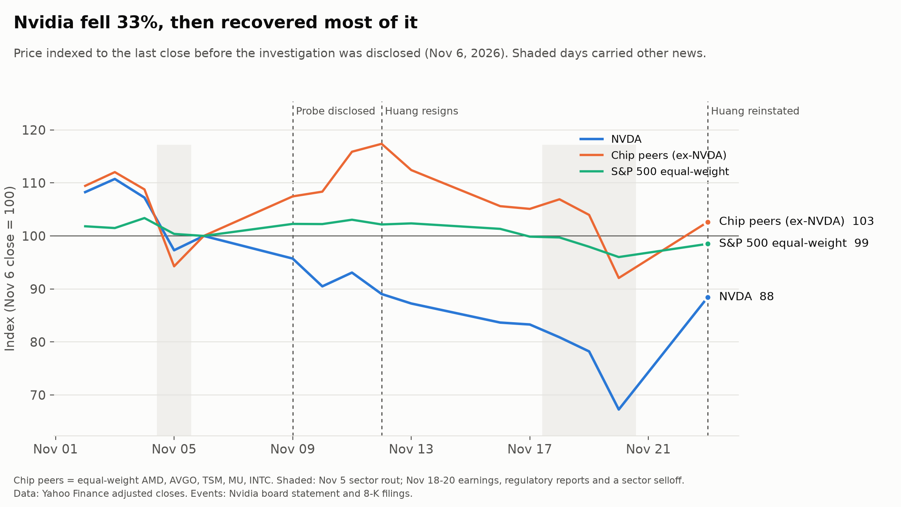
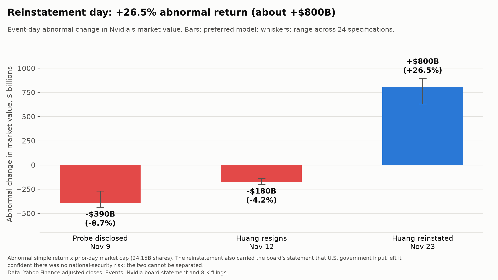
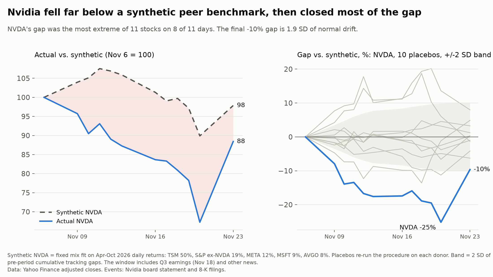
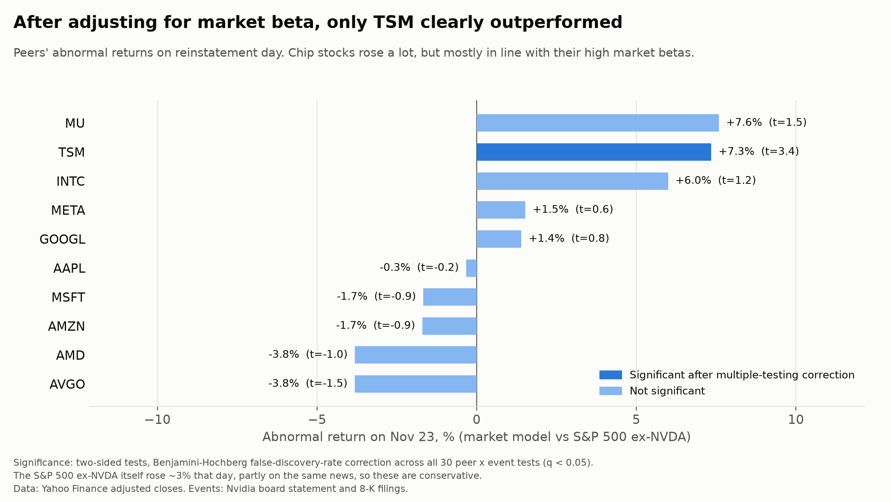
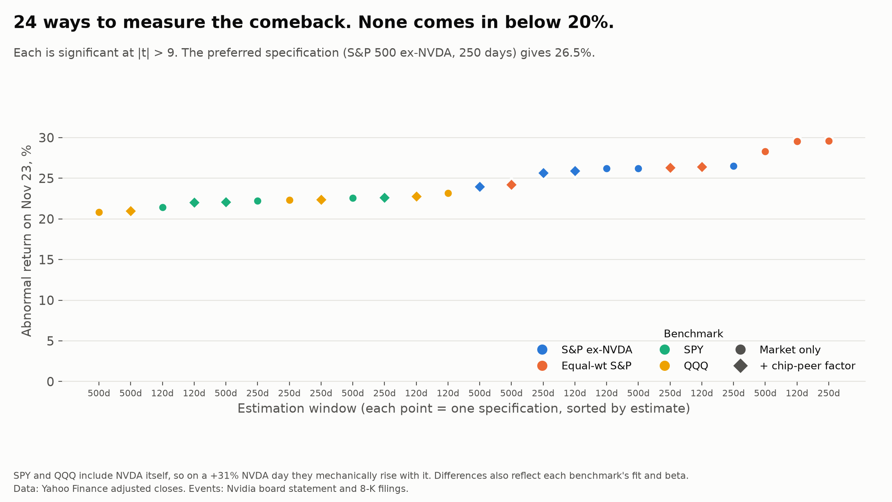

# Nvidia Without Jensen Huang: Eleven Days in November

*An event study of what Nvidia's stock did when its CEO was investigated, quit, and then came back.*

On Sunday, November 8, 2026, Nvidia's board put out a short statement saying it was investigating its own CEO. Jensen Huang had told employees he'd had a relationship with a business executive whom U.S. intelligence reportedly suspected of spying for China. Four days later he resigned, and CFO Colette Kress stepped in as interim CEO. On November 17 the board chair said Huang would not be coming back. Six days after that, the board brought him back anyway.

That gave the market eleven trading days to price Nvidia with its founder, then without him, then with him again. Over that stretch the stock lost a third of its value (about $1.5 trillion at the low) and then got most of it back. I wanted to know what each of those switches was worth, and how much of the slide had anything to do with Huang at all.

The short answer is that his return mattered far more than his exit. On the morning he was reinstated, Nvidia gained about 26.5% more than the market can explain. That's roughly $800 billion of value in one session. The resignation barely registered by the closing bell. And most of the slide in between happened on days when the news was about something else.



## Day by day

| | Nov 9: probe disclosed | Nov 12: Huang resigns | Nov 23: Huang reinstated |
|---|---|---|---|
| Stock's actual move | -4.3% | -4.3% | **+31.5%** |
| Move beyond what the market explains | -8.7% | -4.2% | **+26.5%** |
| In dollars | -$390B | -$180B | **+$800B** |
| Range across 24 model variations | -5.9% to -9.7% | -3.3% to -4.7% | +20.8% to +29.6% |
| Statistically clear? | Yes, in all 24 | Depends on the test | Yes, in all 24 |

"Beyond what the market explains" is the abnormal return. I estimate how Nvidia normally moves with the market, using a year of data that ends on October 23, before any of this started. Whatever Nvidia did on top of that is the abnormal part. The dollar figure applies that percentage to Nvidia's market value the night before.

## The day he quit, the market shrugged (eventually)

The resignation came out around 9 a.m. Eastern on November 12. Nvidia opened 13% lower and at one point was down more than 14%. By the close it had clawed most of that back and finished down 4.3%. After adjusting for the market, the drop was 4.2%. Whether that counts as statistically significant depends on how you handle volatility. A standard test says yes (t = -2.1). A GARCH model, which lets volatility rise during a turbulent stretch, says no (p of about 0.1).

My read is that most of the exit was already priced in. In the two days after the investigation became public, Nvidia had already fallen about 14% relative to the market. By the time Huang actually left, a lot of investors had placed that bet.

The comeback was the opposite. The board chair had said publicly that Huang wasn't returning. When he did, the stock opened up 33% and closed up 31.5%. After adjusting for the market, that's a 26.5% abnormal move. That's nearly 13 times a normal day's noise and bigger than any day in the previous year.

There's one catch. The board's filing said it had received input from senior levels of the U.S. government and was confident Huang's return posed no national security risk. So the $800 billion is partly Huang and partly relief that Washington seemed to be on board. I can't cleanly split the two.


## Measuring Nvidia against itself

The first trap I ran into: the obvious yardstick, the S&P 500, is about 8% Nvidia. On a day when Nvidia jumps 31%, the S&P goes up partly *because of* Nvidia. Measure against it and you're comparing Nvidia with a slice of itself, which knocks a few points off the answer.

So I rebuilt the S&P 500 without Nvidia. I started from Nvidia's index weight on October 23 (7.77%, according to WhichIndex) and let it drift each day with Nvidia's price relative to the index. To check it, I compared the weights it implies on other dates with published holdings: 8.45% vs. 8.50% on October 2, and 7.59% vs. 7.58% on October 31. It also tracks Nvidia much better than the equal-weight S&P 500 does (R² of 0.24 vs. 0.05), so it became my main benchmark.

## Where the losses actually came from

From November 9 through 23, Nvidia trailed the market by about 9.7%, or roughly $440 billion. The three Huang days, added together, come out *positive*, because the comeback outweighs the two drops. Every bit of the net loss sits on the other eight days.

A lot happened on those days. Nvidia reported third-quarter earnings after the close on November 17: $115.8 billion in revenue, up 103%, delivered by an interim CEO. The same day, the Wall Street Journal reported an SEC probe. Reports followed of a halt to H200 sales to China and a subpoena from California's attorney general. Then on Friday, November 20, chip stocks sold off hard. Nvidia opened only slightly lower, slid all day, and closed down 14%, its worst session of the episode.

None of that is a Huang event, so I don't count it as one. Those days are shaded in the charts and listed with sources in [`data/confounders.csv`](data/confounders.csv).



## A stand-in Nvidia

A regression is one way to estimate what Nvidia "should" have done. Another is to build a stand-in. I found the mix of stocks that best tracked Nvidia's daily returns from April to October: about half TSMC, plus the S&P 500 ex-Nvidia, Meta, Microsoft and Broadcom. Then I froze that mix and let it run through November.

At the November 20 low, the real Nvidia was 25% below its stand-in, about five times the gap you'd normally see over that many days. After the reinstatement the gap shrank to about 10%, which is just inside two standard deviations of normal drift.

To make sure this wasn't an artifact of the method, I ran the same thing on each of the 10 stocks in the pool, pretending each one was the company in the news. Nvidia had the most extreme gap on 8 of the 11 days. With only 11 stocks the smallest possible p-value from that test is 0.09, so I treat it as strong supporting evidence rather than proof. Swapping out TSMC, or using only non-chip stocks, gives the same picture.



## Did the rest of the chip world ride along?

On reinstatement day, Micron rose 19%, Intel 16% and TSMC 14%. That looks like Nvidia lifting the whole supply chain. But the broader market was up about 3% that day, and these stocks typically move two to three times as much as the market does. Once you account for that, and for the fact that I ran 30 tests (10 stocks across 3 events), only TSMC stands out, at about 7% above what the market predicts.

I also thought I'd spotted money rotating into AMD and Broadcom while Huang was gone. It didn't survive the same correction.



## What I got wrong the first time

When I stress-tested my first draft, several things fell apart.

- I converted log returns into dollars the wrong way, which understated the comeback by about $40 billion.
- I called the episode a "round trip." It wasn't. Nvidia still ended about 10% below its stand-in.
- I missed that earnings and several regulatory stories landed in the middle of the window.
- My main benchmark was the equal-weight S&P 500, which barely tracks Nvidia.
- The rotation story and most of the spillover story disappeared once the benchmark was better and the multiple testing was handled properly.

Fixing all of that made the headline number slightly larger and made the rest of the story smaller and more honest.

## How sure am I about the $800 billion?

Fairly sure about the direction and the rough size. I re-estimated the reinstatement-day move 24 ways: three estimation windows, four different market benchmarks, with and without a chip-sector factor. Every version lands between +21% and +30%, and the weakest is still more than 9 standard errors from zero. A GARCH model fit only on pre-event data gives a z-score of 6.3.

The disclosure day holds up in all 24 versions. The resignation day holds up in 19, which is why I call it mixed.



## What this can't tell you

It can't tell you what Huang is personally worth. The reinstatement came bundled with the government reassurance, and I have no way to separate the two.

The disclosure may also have leaked. Reports about Megaspeed, the company the executive worked for, started on October 29, and Nvidia had an unexplained 6.3% abnormal drop on November 4. Some of the Nov 9 reaction may have been priced early.

Each event is a single day for a single company, so these are case-study numbers and not a general rule about CEOs.

Finally, the investigations are still open. This project measures how the market reacted. It takes no position on any of the allegations.

## Method, for the quants

1. **Estimation window:** 250 trading days ending October 23, 2026. That's before the Megaspeed reports, the November 3 midterms and the November chip selloff.
2. **Normal returns:** OLS of Nvidia's daily log return on the S&P 500 ex-Nvidia. Alternatives are the equal-weight S&P 500, SPY and QQQ, each with or without an equal-weight chip-peer factor (AMD, AVGO, TSM, MU, INTC). I don't prefer the chip-peer version, because those stocks reacted to the same news, and that biases different events in different directions.
3. **Abnormal return** is cumulative actual simple return minus cumulative predicted simple return. Times the prior market cap, that gives the dollar gap against the counterfactual.
4. **Inference:** t-statistics on summed log abnormal returns, GARCH(1,1) z-scores with Student-t errors (fit pre-event, filtered forward with fixed parameters so sigma at *t* only uses data through *t-1*), and empirical p-values from same-length residual sums.
5. **Stand-in Nvidia:** a returns-based synthetic control. Weights are non-negative, sum to one and minimise tracking error over April to October 2026. Inference uses placebo runs on every donor, plus a noise band from pre-period tracking gaps.
6. **Spillovers:** a market model for each peer, with a Benjamini-Hochberg correction across all 30 peer-event tests.
7. **Event timing:** the board statement came out on a Sunday, and both 8-Ks were reported around 9 a.m. Eastern, before the open. Day 0 is the first session after each announcement. See [`data/events.csv`](data/events.csv).

## Run it yourself

Needs Python 3.12.

```bash
pip install -r requirements.txt
python src/run_all.py            # rebuilds every number and chart from the saved data
python src/run_all.py --fetch    # downloads fresh prices first (numbers may shift slightly)
```

All the study settings live in [`src/config.py`](src/config.py). Results land in `output/`:

| File | What's in it |
|---|---|
| `event_cars.csv` | Abnormal returns for every event, window and model, plus episode totals |
| `robust_volatility.csv` | Standard, GARCH and pre-episode GARCH test statistics |
| `robust_spec_grid.csv` | All 24 model variations |
| `synthetic_control_*.csv` | Stand-in weights, path, placebos and sensitivity checks |
| `peer_spillovers.csv` | Peer abnormal returns with corrected p-values |

## Sources

- Nvidia board statement, Nov 8: https://nvidianews.nvidia.com/news/statement-from-nvidia-board-of-directors
- Resignation 8-K, Nov 12: https://www.sec.gov/Archives/edgar/data/0001045810/000104581026000082/nvidiaannouncesceotransiti.htm
- Reinstatement 8-K, Nov 23: https://www.sec.gov/Archives/edgar/data/0001045810/000104581026000090/nov23pressrelease.htm
- CNBC live coverage of the resignation: https://www.cnbc.com/2026/11/12/nvidia-jensen-huang-ceo-live-updates.html
- Q3 fiscal 2027 results: https://investor.nvidia.com/news/press-release-details/2026/NVIDIA-Announces-Financial-Results-for-Third-Quarter-Fiscal-2027/
- Board chair on not reinstating Huang, and the reported SEC probe: https://www.khaleejtimes.com/business/nvidia-wont-rehire-jensen-huang-sec-probing-chipmaker
- S&P 500 weights, Oct 23: https://whichindex.com/indexes/sp-500/
- Prices: Yahoo Finance via `yfinance`
