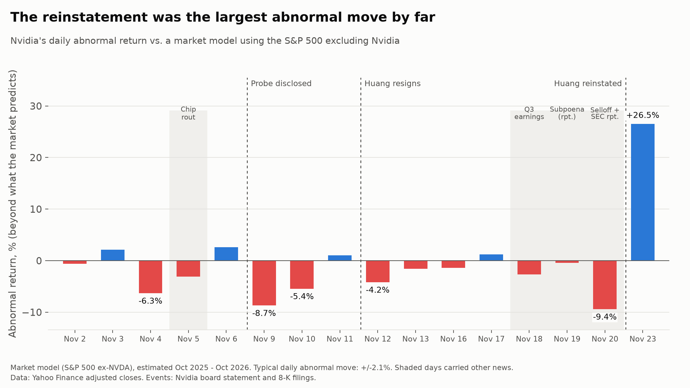

# How the Market Priced a CEO's Exit and Return: Nvidia, November 2026

**TL;DR:** Using an event study, volatility-robust tests and a synthetic peer benchmark, I estimate that Nvidia's stock rose **+26.5% beyond what the market explains (≈ +$800B)** on the day Jensen Huang was reinstated as CEO. That is the largest abnormal move in the sample and is significant in all 24 model specifications. The resignation-day drop was smaller, and whether it is significant depends on how volatility is modelled.

In November 2026, Nvidia's board disclosed an investigation into CEO Jensen Huang (Nov 8), Huang resigned (Nov 12), and the board reinstated him (Nov 23). Over eleven trading days the market priced Nvidia with Huang, then without him, then with him again. This project measures those reactions and is careful about what else was happening at the same time.


## Key findings

| Event (first trading day) | Raw return | Abnormal return: preferred model (range, 24 specs) | Constant-vol t / GARCH z | Abnormal Δ market value: preferred (range) |
|---|---|---|---|---|
| Investigation disclosed (Nov 9) | -4.3% | **-8.7%** (-9.7% to -5.9%) | -4.2 / -3.5 | **-$390B** (-$440B to -$270B) |
| Huang resigns (Nov 12) | -4.3% | **-4.2%** (-4.7% to -3.3%) | -2.1 / -1.4 | **-$180B** (-$200B to -$140B) |
| **Huang reinstated (Nov 23)** | **+31.5%** | **+26.5%** (+20.8% to +29.6%) | **10.9 / 6.3** | **+$800B** (+$630B to +$900B) |

*Preferred model:* NVDA regressed on the S&P 500 **excluding NVDA** over 250 trading days. *Abnormal return:* cumulative actual minus model-predicted simple return. *Δ market value:* abnormal return × prior-day market cap.

1. **The reinstatement was the clear shock.** A +26.5% abnormal return is about 13 times the typical daily abnormal move (±2.1%) and larger than any day in the prior year. It stays highly significant after allowing for the turbulent month (GARCH z = 6.3). The board chair had said on Nov 17 that Huang would not be reinstated, so the reversal was a genuine surprise.
2. **The resignation-day evidence is mixed.** The -4.2% drop is significant with a constant-volatility t-test (t = -2.1, significant in 19 of 24 specs) but not once volatility is allowed to rise with the episode (GARCH p = 0.09 to 0.13). Combined with the -13.9% two-day abnormal loss after the disclosure, this is *consistent with* a partly anticipated exit. CNBC reported that the stock opened more than 13% lower that morning before recovering to close down 4.3%.
3. **The episode's net loss came from the non-Huang days.** Across the full Nov 9 to 23 episode, NVDA's abnormal return was -9.7% (-$440B). The three Huang-event days net *positive*. The losses accumulated on the other eight days, which carried other news: Q3 earnings (Nov 18), reported SEC and California AG inquiries, a China export halt, and a sector-wide selloff on Nov 20 (see [`data/confounders.csv`](data/confounders.csv)).
4. **Spillovers were mostly market beta.** Chip stocks rose 10%+ on Nov 23, but so did the broad market (the S&P 500 ex-NVDA was up about 3%), and chip stocks have high betas. After adjusting for beta and correcting for 30 simultaneous tests (Benjamini-Hochberg), only **TSMC** (+7.3%, t = 3.4) shows a significant abnormal gain. An apparent "rotation into rivals" during Huang's absence does not survive the correction.




## Synthetic peer benchmark

As a model-free cross-check, I build a "synthetic NVDA": a fixed, non-negative mix of comparable stocks that best tracked NVDA's daily returns from April to October 2026. The mix is TSMC 50%, S&P 500 ex-NVDA 19%, Meta 12%, Microsoft 9% and Broadcom 8%, with a daily tracking error of 1.75%. This is a returns-based variant of synthetic control; the classic Abadie-Diamond-Hainmueller method matches outcome *levels*.

- **Trough:** at the Nov 20 low, NVDA was **25% below** its synthetic twin, about 5 SD of normal tracking drift.
- **After reinstatement:** the gap closed to **-10%**, about 1.9 SD of normal drift, so it is not clearly distinguishable from noise.
- **Placebos:** re-running the procedure on each of 10 donor stocks, NVDA's gap is the most extreme of the 11 on 8 of 11 days, and it has the largest post/pre fit ratio (4.1 vs 0.5 to 2.1). With 11 units, the smallest attainable permutation p-value is 1/11 ≈ 0.09, so this is strong but not conventionally "significant" evidence.
- **Donor contamination:** TSMC and Broadcom reacted to the news themselves. Re-fitting without TSMC or with non-chip donors only gives a deeper trough (-29%) and a similar final gap (-10% to -12%).
- **Not Huang-only:** the window includes earnings and the other news above, so the gap measures the whole episode, not Huang alone.


## Robustness

**Choice of benchmark.** Cap-weighted indices hold NVDA itself: about 7.8% of the S&P 500 on Oct 23, 2026 ([WhichIndex](https://whichindex.com/indexes/sp-500/)). On a +31% NVDA day, SPY and QQQ rise *because of* NVDA. I strip NVDA out of SPY using a daily weight anchored on that figure and drifted with relative prices. The implied weights match published holdings within about 0.1pp (8.45% vs 8.50% on Oct 2; 7.59% vs 7.58% on Oct 31). The S&P 500 ex-NVDA fits NVDA far better than the equal-weight index (R² 0.24 vs 0.05). Differences between benchmarks reflect fit and beta as well as NVDA's weight.

**Specification grid.** 3 estimation windows (120 / 250 / 500 days) × 4 benchmarks (S&P 500 ex-NVDA, equal-weight S&P 500, SPY, QQQ) × with or without a chip-peer factor = 24 specifications. The reinstatement jump is +20.8% to +29.6%, with |t| > 9 in every case. The disclosure is significant in 24/24 and the resignation in 19/24.

**Volatility.** Each event-day abnormal return is re-scaled by a GARCH(1,1)-t conditional volatility. The model is fit on the estimation window and filtered forward, so sigma for day *t* uses only data through *t-1*. Because the episode's own shocks raise sigma for later events, I also report z using sigma frozen before the episode. Both versions are in [`output/robust_volatility.csv`](output/robust_volatility.csv).

**The chip-peer (industry) model** is reported but not preferred. The peers reacted to Nvidia's news themselves (some rallied on Nov 9, partly on AMD's own analyst upgrade, and all rallied on Nov 23), so controlling for them biases E1/E2 and E3 in opposite directions.


## Method

Short-horizon event study (MacKinlay, 1997, *Journal of Economic Literature*):

1. **Estimation window:** 250 trading days ending Oct 23, 2026. That is before the late-October Megaspeed reports, the Nov 3 midterm elections and the November chip selloff.
2. **Normal returns:** OLS of NVDA's daily log return on the S&P 500 ex-NVDA (alternatives in *Robustness*).
3. **Abnormal return** over a window = cumulative actual simple return − cumulative predicted simple return. Multiplied by the market cap at the close before the window, this gives the dollar gap between actual and counterfactual value.
4. **Inference:**
   - t-statistics on summed log abnormal returns, using estimation-window residual volatility.
   - GARCH(1,1)-t z-scores.
   - Empirical p-values from the distribution of same-length residual sums, reported as (k+1)/(N+1), so they are never 0.
5. **Event timing:** dates come from Nvidia's board statement (Nov 8, a Sunday) and its 8-K filings (Nov 12, Nov 23). Contemporaneous reports place both 8-K announcements around 9:00 a.m. ET, before the open; the filings themselves give no time. Day 0 is therefore the first trading session after each announcement ([`data/events.csv`](data/events.csv)).

## Limitations

- **Bundled news on reinstatement day.** Nvidia's 8-K said the board received input from senior levels of the U.S. government and was confident Huang's return posed no national-security risk. Some of the +$800B may reflect that reduced regulatory risk rather than Huang himself.
- **Other news inside the window.** Nov 5, and Nov 18 to 20, carried earnings, regulatory reports (some unconfirmed and single-sourced) and sector moves. The event-day estimates avoid these days. The episode and synthetic-control totals do not.
- **Possible leakage.** Reports about Megaspeed began on Oct 29, before the board's Nov 8 statement. NVDA also had an unexplained -6.3% abnormal day on Nov 4. Some of the disclosure reaction may have been priced early.
- **Spillovers in the controls.** The broad market rose about 3% on Nov 23, partly on the same news, so market-adjusted estimates for that day are, if anything, conservative.
- **Small samples.** Each event is one observation, and the placebo test has 10 donors (minimum p = 0.09). These are case-study estimates, not general laws about CEO value.
- **A developing story.** Investigations are ongoing. This analysis measures market reactions only and takes no position on any allegations.

## Reproduce

Requires Python 3.12.

```bash
pip install -r requirements.txt
python src/run_all.py            # reproduces every number and chart from the frozen data in data/
python src/run_all.py --fetch    # optional: re-download prices first (results may change)
```

`--fetch` keeps only completed U.S. sessions and refuses to overwrite `data/` if any ticker fails to download. Study settings (dates, tickers, benchmark weight) live in [`src/config.py`](src/config.py).

| Output | Contents |
|---|---|
| `output/event_cars.csv` | Abnormal returns for every event, window and model, plus episode totals |
| `output/robust_volatility.csv` | Constant, GARCH and pre-episode-GARCH test statistics |
| `output/robust_spec_grid.csv` | The 24-specification grid |
| `output/synthetic_control_*.csv` | Weights, path with noise band, placebos, daily ranks, donor sensitivity |
| `output/peer_spillovers.csv` | Peer abnormal returns with Benjamini-Hochberg-adjusted p-values |

## Possible extensions

- Intraday data, to separate the pre-market reaction from the regular session (the Nov 12 open was far below the close).
- Options-implied volatility around each event.
- Comparison with other founder-CEO exits and returns (e.g., Steve Jobs in 1997).
